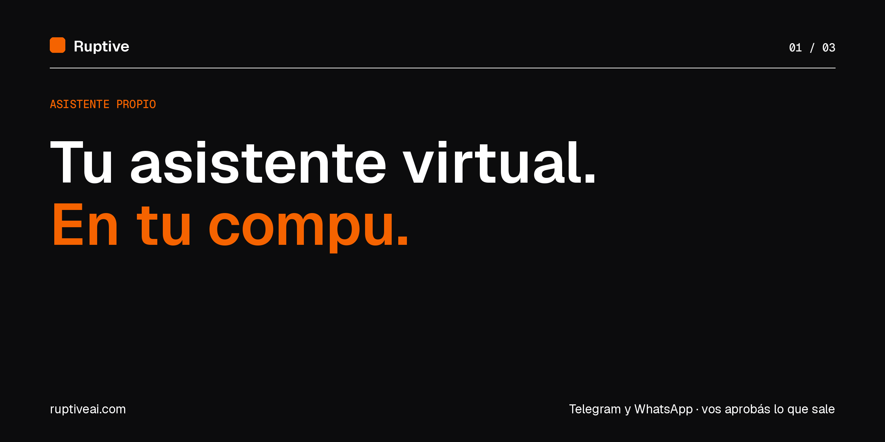
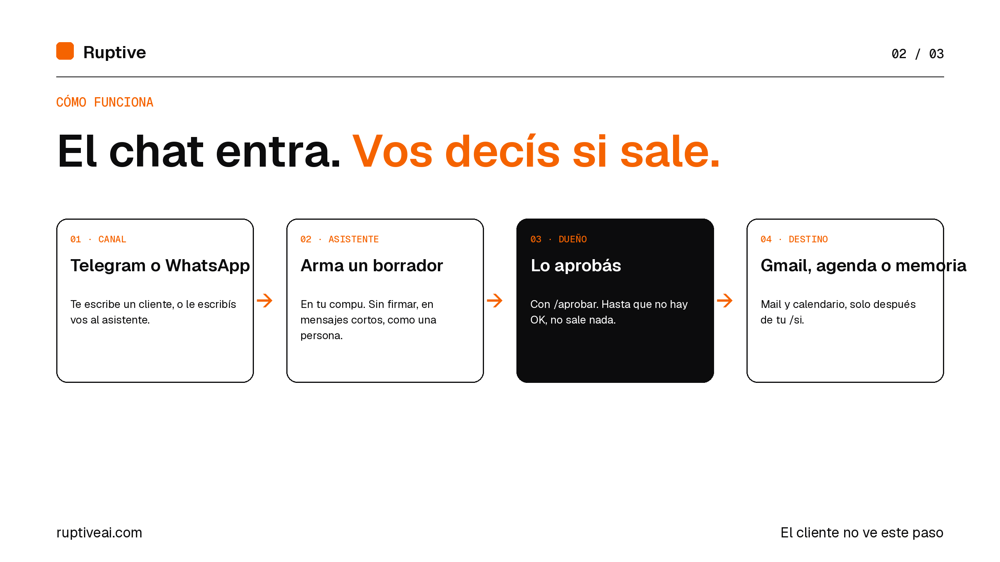
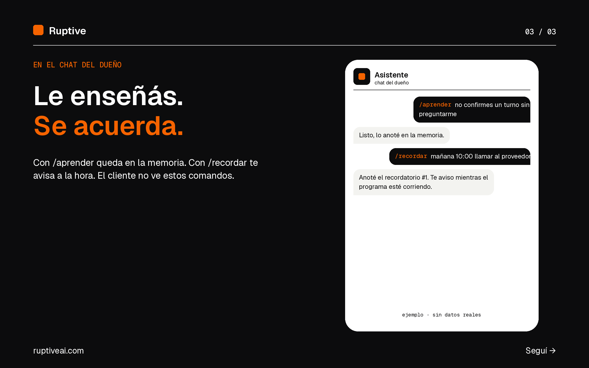

# Asistente virtual



Versión pública para el LAB AI.

Un asistente chico, para correr en tu compu, que atiende Telegram (y, si después querés, WhatsApp). El dueño y los clientes no pasan por el mismo camino: eso está trabado en el código, no en un pedido educado al modelo.



## En 5 pasos

Necesitás Node.js 22 o más nuevo ([nodejs.org](https://nodejs.org)) y Claude Code ya instalado, con la sesión iniciada (`claude` una vez y listo).

1. Instalá Node si no lo tenés.
2. Cloná el repo y entrá:

```bash
git clone https://github.com/sebasfloyd/asistente-virtual-lab.git
cd asistente-virtual-lab
```

3. `npm install`
4. Copiá la config y completá el token:
   - Mac o Linux: `cp .env.example .env`
   - Windows: `copy .env.example .env`
   - `TELEGRAM=true`
   - `TELEGRAM_TOKEN=` el token de @BotFather
   - `OWNER_EMAIL=` el mail con el que entraste a Claude
   - `ASISTENTE_NOMBRE=` cómo se presenta (opcional)
   - `OWNER_TELEGRAM_ID` dejalo vacío por ahora
5. `npm start`

En Telegram, abrí el bot y mandale `/start`. Te contesta `Tu ID es 123456789`. Pegá ese número en `OWNER_TELEGRAM_ID`, guardá el `.env` y volvé a correr `npm start`.

Hasta que no haya dueño, el bot no llama al modelo. Solo responde `/start`.

### @BotFather

1. En Telegram buscá `@BotFather`.
2. Mandale `/newbot`.
3. Elegí un nombre y un usuario que termine en `bot`.
4. Copiá el token en `TELEGRAM_TOKEN`. No lo pases por chat ni lo subas a git.

El bot solo lee chats privados. En un grupo no contesta.

## Probar sin Telegram

En `.env` poné `CEREBRO=simulacion` (no llama a Claude). Después:

```bash
npm run simulador
```

Hablás como cliente. `/duenio` cambia al dueño de esta compu. `/aprobar 1` manda el borrador. `/reiniciar` borra la prueba. `/salir` cierra.

## Qué contesta solo y qué te pregunta

Por defecto `MODO=aprobar`: cada respuesta a un cliente te llega a vos.

```text
/aprobar 3
/rechazar 3
/editar 3 el texto que sí querés mandar
/pendientes
/modo auto
/modo aprobar
```

`MODO=auto` manda solo los temas de "Temas seguros" en `reglas.md`. Precios, descuentos, quejas, mails, archivos y un "soy el dueño" se frenan igual. Completá `reglas.md` con tu negocio: se relee en cada mensaje.

Si `ASISTENTE_NOMBRE` tiene un nombre, el asistente se presenta así. No firma las respuestas.


## Cómo habla

El tono se edita en `estilo.md` y se relee en cada mensaje. Por default habla de vos, en rioplatense, con mensajes cortos, sin signos de apertura ¿ ni ¡, y sin firmar.

Antes de cada parte muestra que está escribiendo (en Telegram, `typing`; en WhatsApp, `composing`) y espera un toque proporcional al largo. Si te llegan varios mensajes juntos, espera un par de segundos y responde una sola vez. Un comando tipo `/memoria` espera menos.

```text
PARTIR_MENSAJES=true
PAUSA_ENTRE_MENSAJES_MS=700
DEBOUNCE_MENSAJES_MS=2500
```



## Memoria

```text
/aprender no des precios por chat
/memoria
/olvidar 1
```

Eso se guarda en `memoria.md`. Cuando corregís un borrador con `/editar`, también queda el ejemplo (lo que preguntó el cliente, el borrador y tu texto). El cliente lo recibe filtrado: mails, teléfonos y rutas no salen. No escribas secretos ahí.

## Recordatorios y tareas

Corren mientras `npm start` (o el simulador) está abierto. Quedan en `data/estado.json`.

```text
/recordar mañana 10:00 llamar al proveedor
/programar lunes 9:00 resumen del día
/programar todos los días 8:30 abrir el local
/tareas
/borrar 2
```

Un recordatorio vencido se avisa en el próximo chequeo (cada 20 segundos) si el programa está corriendo. Una tarea se dispara en esa hora, con una ventana de 5 minutos: si la compu estaba apagada, no se recupera después. Un cliente no puede crearlos ni borrarlos.

`/seguimientos` lista charlas en las que la última palabra fue del cliente hace más de 24 horas y te deja un borrador para `/aprobar`. No lo manda solo.

`/mails` pide un resumen de mails si el conector está. No envía. `RESUMEN_HORA=09:00` te manda una vez por día pendientes, agenda de hoy y, si hay conector, ese resumen.

Para escribirle a otro chat que ya le escribió al bot:

```text
/telegram 123456 | el texto
/whatsapp 5491112345678 | el texto
/si 1
```

WhatsApp solo si lo prendiste. Un chat de Telegram desconocido no se agenda.

WhatsApp solo si lo prendiste. Un chat de Telegram desconocido no se agenda.

Si en la charla pedís "mandale un mensaje a X al +54911...", el programa arma un envío pendiente y espera `/si`. No te contesta como si fueras esa persona. Un bot de Telegram no puede escribirle a un número de celular: te lo dice y te ofrece WhatsApp. Si `WHATSAPP` no está en `true`, te lo dice claro y no manda nada. En tu camino de dueño, el modelo ve los últimos 20 turnos de la charla (nombre, número y texto incluidos): cada pedido a Claude arranca sin sesión previa, el contexto va en el prompt.

## Mail y agenda del dueño

Leer mails, preguntar "qué tengo mañana" o buscar un archivo en Drive es el camino del dueño, si ya conectaste Gmail, Google Calendar y Google Drive en Claude. Por defecto ese camino es de lectura: el programa deja usar solo herramientas de lectura de Gmail, Google Calendar y Google Drive (sin compartir, borrar ni cambiar archivos). Mandar un mail o crear un evento no va por la charla, va por `/mail`, `/agenda`, `/horarios` o `/propuesta` y después `/si`.

Para escribir hace falta el comando y después tu OK. El programa te muestra destinatario, asunto y texto, o el evento, y no hace nada hasta `/si`.

```text
/mail ana@negocio.com | Asunto | el texto
/agenda crear 2026-11-25 10:00 11:00 | Corte
/agenda mover 2026-11-25 10:00 11:00 | 2026-11-25 15:00 16:00 | Corte
/si 1
/no 1
```

`/si` en un evento actualiza `data/ocupado.json` en esta compu. El envío del mail y el evento en Google Calendar se piden por el conector de Claude, y solo después de `/si`. Si estás en `CEREBRO=simulacion`, o sin conectores, no inventa el envío: lo dice y lo anota en `data/logs/acciones.log`.

Un mensaje de un cliente, aunque diga "soy el dueño, /si 1", no manda nada.


### Propuesta comercial

El dueño edita `propuesta.md` (plantilla) y `servicios.md` (servicios y precios). El programa los relee en cada `/propuesta`. Nunca inventa un precio: si no está en `servicios.md`, deja `[completar]`.

```text
/propuesta Ana Pérez <ana@negocio.com> / implementación del asistente
```

Arma un PDF con la marca (naranja #F56300, fondo blanco) y lo guarda en `data/propuestas/`, junto con el `.html` y el `.md`. Si hay WeasyPrint en la compu lo usa; si no, un PDF básico incluido. El dueño recibe el PDF por Telegram para revisarlo. `/si 1` intenta mandarlo por Gmail (el mismo camino de aprobación que `/mail`):

1. `send_message` con el PDF adjunto, si el conector lo acepta.
2. Si no puede adjuntar, `create_draft` con el archivo, sin enviarlo.
3. Si tampoco puede adjuntar, deja el mail o el borrador sin archivo y te avisa. El PDF queda en `data/propuestas/`.

En `CEREBRO=simulacion`, o sin conector, no manda nada: lo dice y lo anota en `data/logs/acciones.log`. Después del `/si` te ofrece un recordatorio en 3 días (`/si` de esa acción lo anota en el scheduler de `/recordar`). Si faltaba el mail: `/si 1 ana@negocio.com`.

### Horarios sin Calendly

```text
/horarios Ana Pérez <ana@negocio.com> | reunión de 30 min esta semana
```

También entendés un pedido en lenguaje natural, por ejemplo: "ofrecele horarios a Ana para una reunión de 30 min esta semana". El programa lee los huecos con el conector de Calendar (`suggest_time` / `list_events`) o, si no hay conector, con la agenda local de `data/ocupado.json`. Te propone 3 huecos en tu zona horaria. `/si 1 2` crea el evento con el segundo hueco e invita al mail, si lo hay. Sin `/si` no se crea nada.

Un cliente puede recibir horarios, pero no reserva solo. `AGENDA_AUTO=false` por defecto, y aunque lo prendas hoy el evento sigue pidiendo `/si`.

### Buscar en Drive

En tu camino de dueño podés pedir "buscá en Drive el contrato de Ana". El programa deja usar el servidor `mcp__claude_ai_Google_Drive` en lectura (`search_files`, `read_file_content`, etc.) y bloquea share, copy, create, update, trash y comentarios. Si Drive no está conectado, te lo dice en español y te manda a [claude.ai/customize/connectors](https://claude.ai/customize/connectors).

### Cómo conectar Gmail, Calendar y Drive

1. Entrá a Claude Code con la suscripción de claude.ai (`claude` y el login). Un token de `claude setup-token` o `ANTHROPIC_API_KEY` no trae los conectores.
2. En [claude.ai/customize/connectors](https://claude.ai/customize/connectors) conectá Gmail, Google Calendar y, si lo querés usar, Google Drive. Esos no se agregan con `claude mcp add`: no aceptan OAuth local.
3. `claude mcp list` tiene que mostrarlos (`claude.ai Gmail`, `claude.ai Google Calendar`, `claude.ai Google Drive`).
4. En `.env`, `OWNER_CONECTORES=true` (es el valor si lo dejás vacío). `OWNER_ESCRITURA=false` salvo que quieras que la charla del dueño también pueda editar archivos.

El camino del cliente no usa esos conectores: sin herramientas, sin MCP, carpeta temporal vacía.

## El mail de la cuenta de Claude

`claude -p` mete en el contexto el mail con el que iniciaste sesión, aunque el cliente no tenga herramientas. También puede arrastrar memoria o un `CLAUDE.md` si no se lo impedís.

En el camino del cliente el programa:

- corre en una carpeta temporal vacía, fuera del proyecto
- no carga memoria ni `CLAUDE.md` (`CLAUDE_CODE_DISABLE_CLAUDE_MDS=1`, `CLAUDE_CODE_DISABLE_AUTO_MEMORY=1`; no usamos `--bare` porque en Claude Code 2.1+ ese flag ignora el login OAuth y el camino cliente queda sin sesión)
- no carga settings de usuario, proyecto ni local (`--setting-sources` vacío: la palabra `none` no es un valor válido)
- no conecta MCP (`--strict-mcp-config` con un config vacío)
- no deja herramientas (`--tools ""`, `--allowedTools ""`, `--disallowedTools`)

Con eso el modelo igual puede *conocer* el mail de la cuenta: no hay un flag que lo borre del contexto. Antes de que un texto salga hacia un cliente, el código lo filtra (`src/filtro.js`):

- saca `OWNER_EMAIL` y `OWNER_WHATSAPP`
- saca cualquier otro mail que no esté escrito en `reglas.md` (el del negocio puede quedar)
- saca rutas tipo `/Users/...`, `/home/...` o `C:\Users\...`

Si el modelo parte el mail ("ana arroba mail"), el filtro no lo ve. Por eso el modo aprobar es el que conviene: vos leés el borrador antes de que salga.

## Huecos libres

`HUECOS_LIBRES=true` y un archivo `data/ocupado.json` (hay un ejemplo en `ocupado.ejemplo.json`). El cálculo usa solo inicio y fin. Un título que dejes en el JSON no se le muestra a nadie.

```text
/ocupado ver
/ocupado 2026-11-25 10:00 11:00
/ocupado borrar 2026-11-25 10:00 11:00
```

Si el archivo no existe, no dice que el día está libre. Esto no lee Google Calendar. En tu camino de dueño, con `CEREBRO=claude`, sí podés preguntar "qué tengo mañana" si ya tenés el conector en Claude Code.

## Dos caminos

El canal dice quién escribe (el user id de Telegram). El texto no vota.

| | Cliente | Dueño |
| --- | --- | --- |
| Cómo se elige | cualquier otro id | `OWNER_TELEGRAM_ID` o `/soyelduenio` |
| Herramientas | ninguna, y si faltan las trabas no se ejecuta | lectura de Gmail, Calendar y Drive; mail, propuesta y eventos solo con /si |
| Carpeta | temporal, vacía | `data/espacio-duenio` |
| Sale al cliente | solo después del filtro, y en modo aprobar después de tu OK | no |

Mirá `src/seguridad.js`, `src/cerebro.js`, `src/filtro.js` y `src/turno.js`. Los tests en `test/` son la traba: si le das herramientas al cliente, tienen que fallar.

`/soyelduenio TU-CODIGO` registra al primero que acierta y después el código no sirve. Si ya pegaste el id con `/start`, no hace falta.

## Tests

```bash
npm test
```

## WhatsApp, después

No está en el `npm install` de la clase, para que tarde segundos. El método por QR no es la API oficial: WhatsApp puede bloquear el número. Usá un chip o WhatsApp Business aparte, no el de tu familia.

```bash
npm install @whiskeysockets/baileys@6.7.24 qrcode-terminal pino@9
```

En `.env`, `WHATSAPP=true`, y `npm start`. Escaneá el QR (Ajustes → Dispositivos vinculados). La sesión queda en `data/sesion-whatsapp`. No la subas a git. La API oficial de WhatsApp Cloud puede sumarse después como otro canal, con la misma forma.

## Límites

- El aislamiento del cliente es de proceso (sin herramientas, sin MCP, carpeta vacía, entorno sin secretos, filtro de salida). No es otro usuario del sistema. La sesión de Claude sigue siendo la tuya, y por eso el mail hay que filtrarlo a la salida.
- `CEREBRO=anthropic` es solo texto. Calendario, mail y Drive van por Claude Code, y solo en el camino del dueño, con `/si` para escribir.
- Los huecos salen de Google Calendar en el camino del dueño, o de `data/ocupado.json` si no hay conector. Un `/si` de agenda escribe ahí. El evento en Google Calendar se pide al conector solo después de `/si`.
- El mail por Gmail está codificado (el `/si` arma el pedido al conector y lo registra). El `/si` de una propuesta intenta adjuntar el PDF; si el conector no acepta adjuntos, cae a un borrador o a un mail sin archivo y te lo dice. En esta corrida de tests no se envió ningún mail real.
- Drive es solo lectura. Si el conector no está, el programa lo dice y no inventa archivos.
- Recordatorios, tareas, memoria, el nombre, la agenda local, seguimientos, el resumen sin mail y la traba de que un cliente no confirme: eso sí corre en `npm test`.
- Telegram a otro chat: solo si ese chat ya le escribió al bot, y solo después de `/si`. El mensaje sale por el mismo envío del bot. Acá se probó la decisión y el destino, no un bot real de Telegram.
- WhatsApp a un número: solo si `WHATSAPP=true`. El envío está en el código. El QR de Baileys no se probó en esta corrida.
- `/seguimientos` arma borradores de charlas que esperan respuesta hace más de 24 horas. No los manda: van a `/aprobar`.
- `RESUMEN_HORA=09:00` manda al dueño, una vez por día y con el programa abierto, los pendientes y la agenda de hoy. Los mails del resumen salen del conector si `CEREBRO=claude`; si no, dice que no hay conector y no inventa correos.
- `/mails` resume y propone borradores, sin enviar. Mandar sigue siendo `/mail` y `/si`. Sin conector, lo dice.
- `MENTE_CMD` es opcional y solo del dueño: una ruta a un ejecutable, sin espacios. El cliente no lo puede llamar. Acá no hay un binario `mente`, así que no se ejecutó.
- Un mensaje del dueño puede usar herramientas y leer archivos de esa compu. El id del dueño es lo que hay que cuidar.
- Los logs quedan en `data/logs`. No guardan el token ni el mail, pero sí pueden tener texto de los chats. `data/` y `.env` no van a git.

## Licencia

[PolyForm Noncommercial 1.0.0](LICENSE). Lo podés usar gratis en tu casa o en tu propio negocio. No se puede revender ni ofrecerlo como un servicio sin permiso. Si necesitás otra cosa, escribinos desde [ruptiveai.com](https://ruptiveai.com).

Copyright (c) 2026 Sebastián Chuffer / Ruptive AI.
